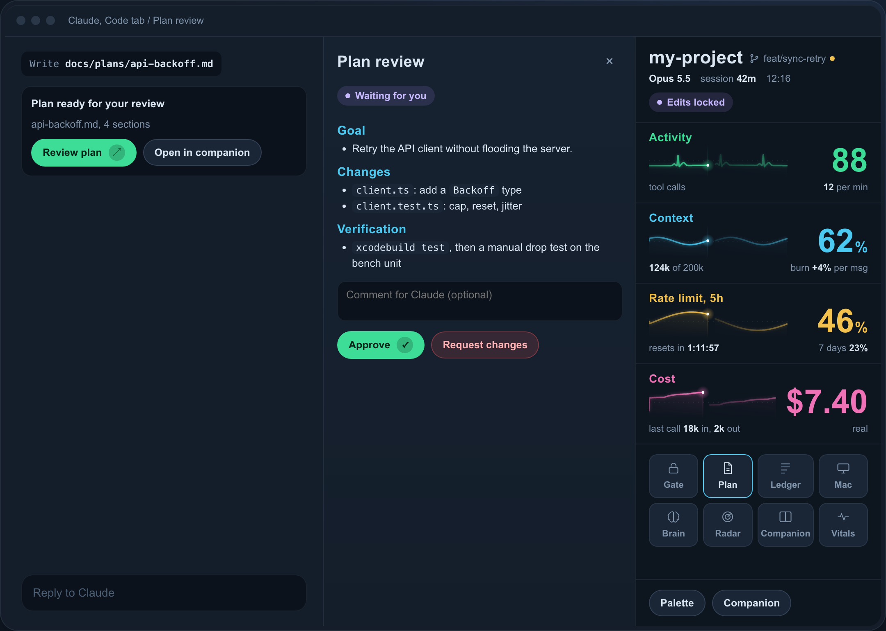
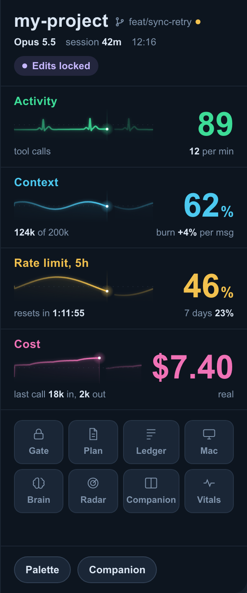
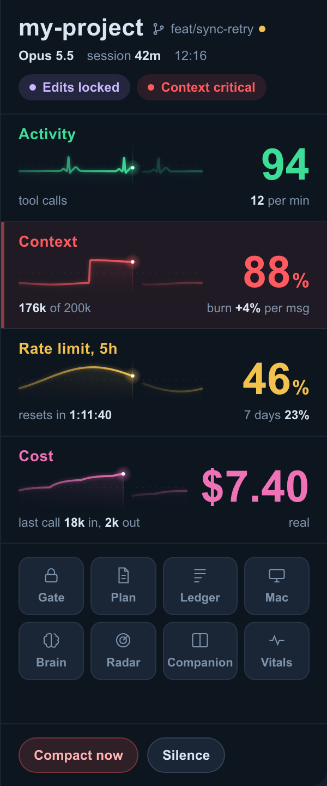
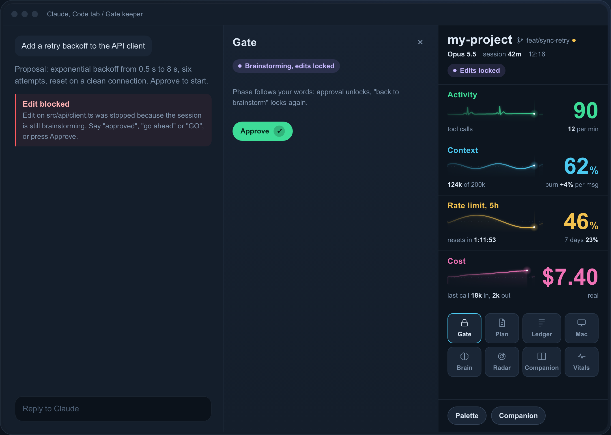
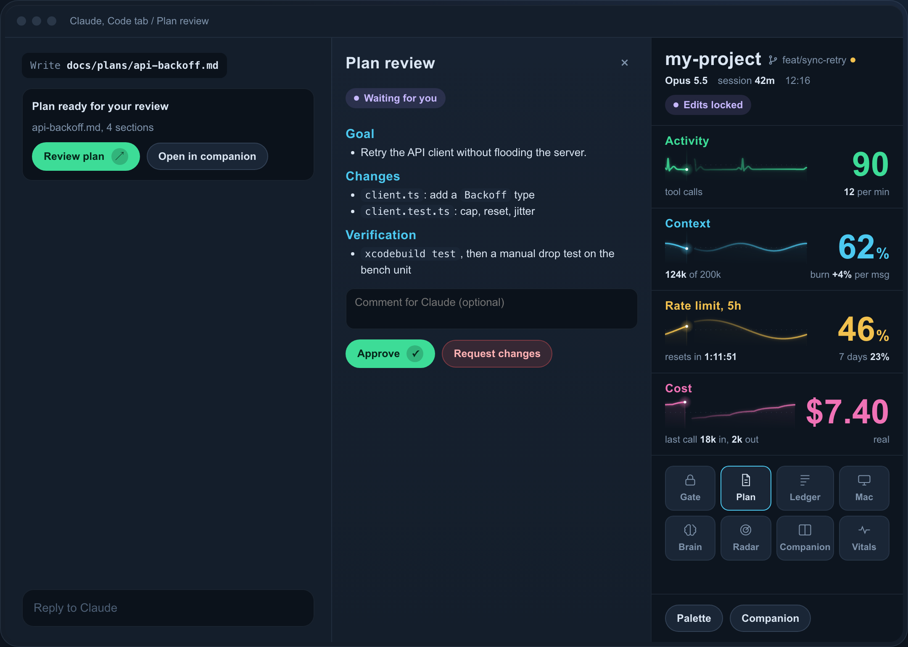
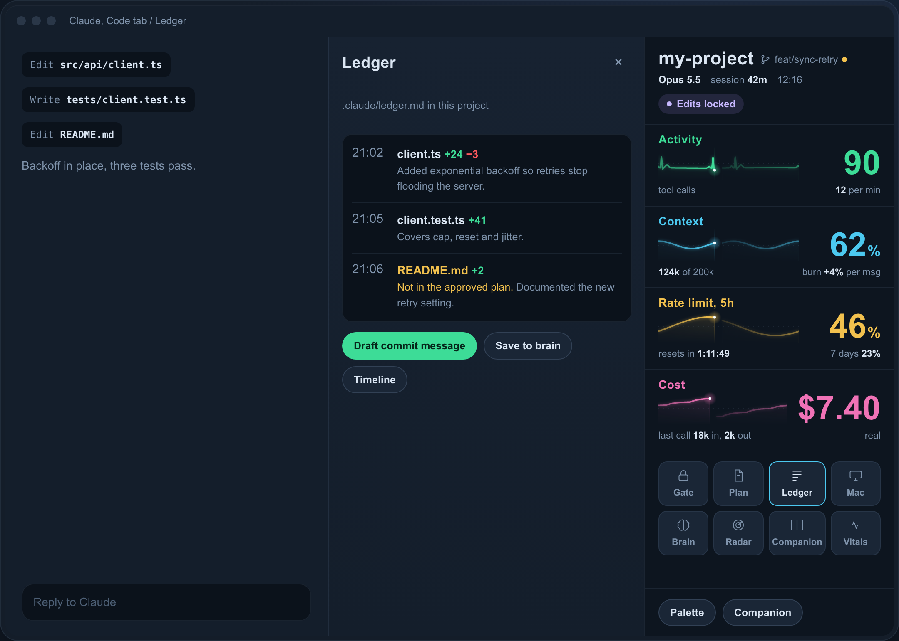
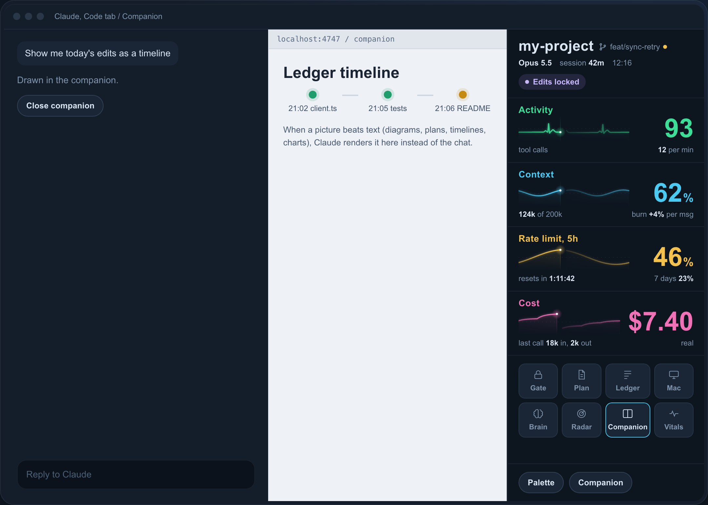
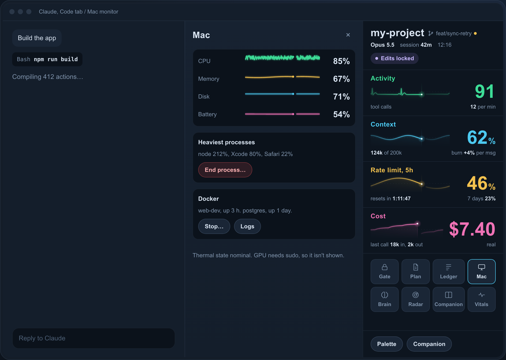
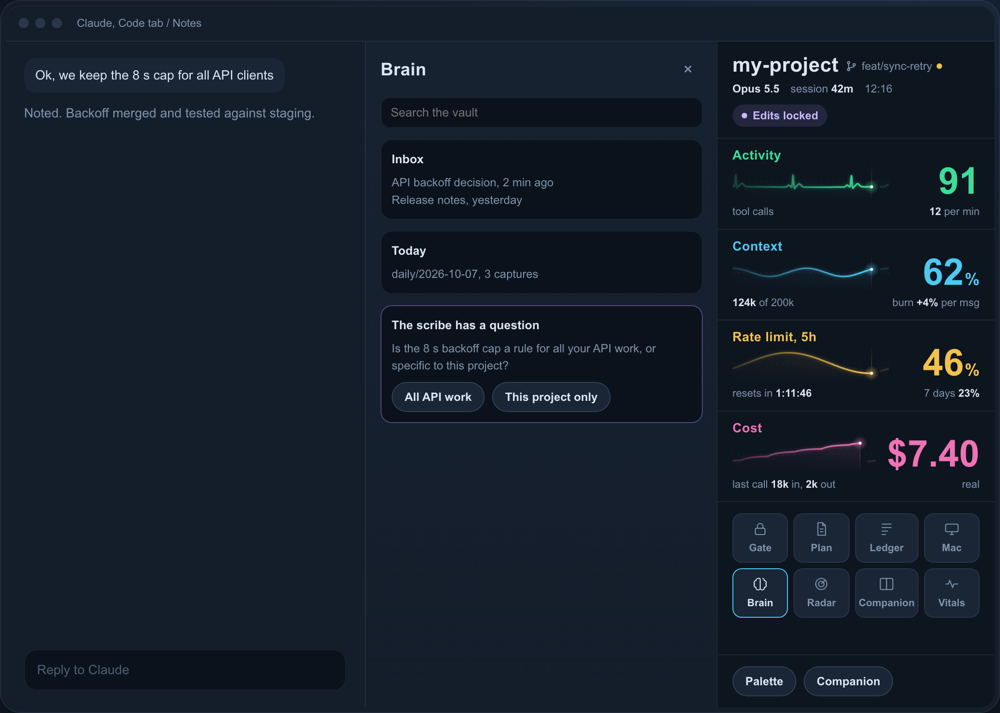
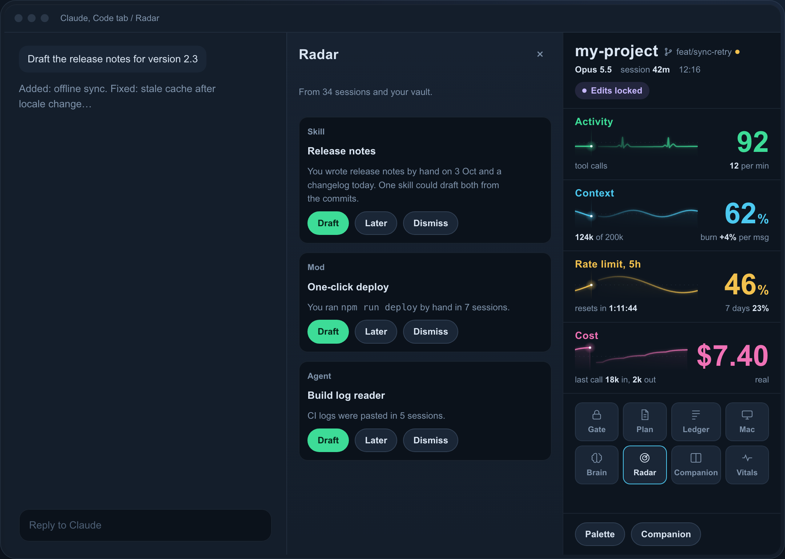

# dotclaude

**A Claude Code plugin that turns one pane into a workspace: live token, context, rate-limit and cost vitals, an edit approval gate, plan review, a change ledger, an Obsidian notes view, Git, subagents and more.**

[](LICENSE)
[](https://docs.claude.com/en/docs/claude-code/plugins)
[](#requirements)

dotclaude is an open-source Claude Code plugin for developers who want to see what their AI coding agent is doing and stay in control of it. It adds a single **Workspace** pane beside the conversation, in the terminal and in the desktop app, with a dashboard-style vitals rail (context window, 5-hour rate limit, real session cost, tool activity) and ten panels you open from its dock.



<sub>Screenshots come from the project's interactive mockup with sample data.</sub>

## Why dotclaude

- **See the session at a glance.** Context usage, the 5-hour rate limit with its reset countdown, and the real cost of the session, drawn as live monitor traces instead of one line of statusline text.
- **Decide before Claude edits.** File edits stay locked while you brainstorm; a message that starts with your approval phrase, or approving a plan, unlocks them.
- **Keep a record.** Every change gets a one-line "why", a project ledger file and a drafted commit message; every model request shows what it cost and which tools it ran.

## Contents

- [Features](#features)
- [Quick start](#quick-start)
- [Configuration](#configuration)
- [Commands](#commands)
- [Workspace layout](#workspace-layout)
- [What runs automatically](#what-runs-automatically)
- [What is sent to the model](#what-is-sent-to-the-model)
- [Privacy and security](#privacy-and-security)
- [Requirements](#requirements)
- [FAQ](#faq)
- [Roadmap](#roadmap)
- [Contributing](#contributing)
- [License](#license)

## Features

### Vitals rail: context, rate limit and cost monitor



The rail shows four channels as live traces: **Activity** (one heartbeat per tool call), **Context** (share, tokens, burn per message), **Rate limit 5h** (share, reset countdown, 7-day share) and **Cost** (the session's real cost total as reported by Claude Code, not a price table). The header shows project, branch, model, session age and status chips. At 80% context the channel turns red and offers **Compact now** (asks first) or **Silence**.



### Gate: approve before Claude edits files



Every session starts in brainstorming: `Edit`, `Write`, `MultiEdit` and `NotebookEdit` are refused. Plans and specs (Markdown files under `docs/plans/`, `specs/` and similar, `*.plan.md`, `*.spec.md`) stay writable, but only inside the session's project, matched on the path relative to the project with symbolic links resolved; a file that is itself a symbolic link is refused. Edits unlock when your message **starts** with an approval word or phrase (`approved`, `go ahead`, `lgtm`, `GO`, ...) followed by the end, a space or one of `. , ! :` (`GO` only alone or before one of those marks): "approved.", "GO" and "GO, do it" unlock; "is it approved?", "approved?" and "GO away" do not. A lock phrase anywhere in a message (`back to brainstorm`, `wait`, `stop`) locks them again. Both lists are configurable. The gate does not block `Bash` or MCP tools; see [Privacy and security](#privacy-and-security).

### Plan review



When Claude writes a plan or spec, or leaves plan mode, the tool row becomes a card with **Review plan** and **Open in companion**. The panel renders the plan, takes an optional comment, and offers **Approve** (unlocks the gate) or **Request changes** (sends your comment as your next message).

### Ledger: what changed, why, and what each request cost



**Edits** lists every successful edit with lines added and removed and a one-sentence reason written by Haiku after the tool has returned, so it never slows Claude down. Entries are appended to `.claude/ledger.md` in your project; files the approved plan does not mention are flagged. **Draft commit message** writes one from the entries.
**Requests** shows one row per model request: model, tokens in and out, real cost, duration and the tool calls it made, with a per-request breakdown.

### Companion: visual answers in the browser pane



A small local page, served by the plugin's own Python server on `127.0.0.1`, opened in the desktop app's browser pane. While it is open, every file Claude sends you, and every new `.html`, `.svg`, `.md`, `.csv` or `.json` file it writes in the project or its scratchpad, appears there automatically, so you never hunt for generated files in Finder. Claude is also told to put diagrams, timelines and charts there instead of in the chat. `/companion show <path>` adds an HTML file from your project, or renders a Markdown file. Every view loads in a sandboxed frame.

### Mac monitor



CPU, memory, disk and battery sparklines, sampled every 5 seconds only while the panel is visible; the heaviest processes with **End process** and your Docker containers with **Stop** and **Logs**. Every stop asks first.

### Notes: Obsidian vault and second brain capture



A live view of your Markdown notes vault (an Obsidian vault works): search, inbox, today's daily note, recent notes. **Capture this session** runs a scribe agent that reads the session, asks you when something is ambiguous, and proposes notes following your vault's conventions. Before anything is written it asks "Save these notes?" and shows each note before saving, in full, with the daily-note line, flagging code blocks. Existing notes are never overwritten; they get a dated section.

### Radar: ideas and plugin advisor



**Ideas** reads your recent prompts and suggests skills, agents and mods you do not have yet, with **Draft**, **Later** and **Dismiss**. **Advisor** reads the catalogs of your plugin marketplaces (plus `anthropics/claude-plugins-official` and `anthropics/skills`), leaves out what you already have, and recommends 5 to 8 existing plugins as cards with a one-click copy of the install command. Both run only when you press **Scan**.

### Git panel

Status, changes, a repository picker and a branch picker, and one primary button (**Push**, **Commit and push**, ...). Before running it shows the files it will commit, the commit message, and a warning for secret-looking files or a public repository. The panel never builds a force push; it drafts the commit message from the ledger, and undoes what it can if a step fails.

### Crew: live subagents

The session's subagents: why each one runs and what it is doing now, with **Stop** (asks first) and **Message**.

## Quick start

At the prompt of a terminal `claude` session:

```
/plugin marketplace add CarloArnone/dotclaude
/plugin install dotclaude@dotclaude
```

Choose the **user** scope, then restart Claude Code or run `/reload-plugins`. The Workspace pane opens at the start of every session (in a terminal, from 144 columns wide); `/vitals` reopens it. Use the dock at the bottom of the rail to open each panel.

Every option has a default, and the plugin works with them as they are. To install from a shell with the defaults saved as real values (so `/config` and `/plugin configure dotclaude@dotclaude` show them, ready to change or leave):

```bash
claude plugin marketplace add CarloArnone/dotclaude
claude plugin install dotclaude@dotclaude --scope user \
  --config 'vaultPath=~/Notes' \
  --config 'vaultName=Notes' \
  --config 'conventionsSkill=notes-conventions' \
  --config "approvalWords=approved, go ahead, proceed, lgtm, ship it, let's do it, sounds good, GO" \
  --config 'lockPhrases=back to brainstorm, wait, stop' \
  --config 'companionPort=4747'
```

The desktop Code tab does not offer `/plugin install`, but a plugin installed at the user scope loads there too. [`mods/INSTALL.md`](mods/INSTALL.md) has the details.

To update: `claude plugin marketplace update dotclaude`, then `/reload-plugins`.

## Configuration

Set options in `/config`, or in `~/.claude/settings.json` under `pluginConfigs["dotclaude@dotclaude"].options` (`pluginConfigs.dotclaude` when loaded with `--plugin-dir`). An option left unset uses its default.

| Option | Default | What it does |
|---|---|---|
| `vaultPath` | `~/Notes` | Your notes vault; `~` is your home folder, absolute paths work too |
| `vaultName` | `Notes` | The vault's name in Obsidian, for `obsidian://` links |
| `conventionsSkill` | `notes-conventions` | A skill under Claude Code's `skills/` folder whose `SKILL.md` holds your vault's note conventions; without it the scribe uses built-in ones |
| `approvalWords` | `approved, go ahead, proceed, lgtm, ship it, let's do it, sounds good, GO` | Comma-separated; a message that starts with one unlocks edits; any case, except a word written in capitals matches only in capitals |
| `lockPhrases` | `back to brainstorm, wait, stop` | Comma-separated; lock edits again (locking wins when a message has both) |
| `companionPort` | `4747` | The companion's port on `127.0.0.1` |

```json
{
  "pluginConfigs": {
    "dotclaude@dotclaude": {
      "options": { "vaultPath": "~/Notes", "vaultName": "Notes" }
    }
  }
}
```

Claude Code's folder is `CLAUDE_CONFIG_DIR` when set, else `~/.claude`.

## Commands

| Command | Opens |
|---|---|
| `/vitals` | The Workspace on the vitals rail |
| `/gate [approve\|lock]` | Gate; `approve` and `lock` change the phase |
| `/plan-review` | Plan review |
| `/ledger [commit-message]` | Ledger; `commit-message` drafts a commit message |
| `/mac` | Mac monitor |
| `/brain [capture [text]]` | Notes; `capture` starts the scribe |
| `/radar` | Radar |
| `/companion [show <absolute path>]` | Companion, starting it if closed |
| `/git-panel` | Git panel |
| `/crew` | Crew |

Switching panels from the dock never runs a slash command and writes nothing to the transcript.

## Workspace layout

Claude Code gives plugin panes a single dock and does not let a plugin place them side by side, so dotclaude draws everything inside one pane, in two columns:

```
┌──────────── main column ─────────────┐  ┌──── side column (when open) ────┐
│ Vitals rail (default)                │  │ Gate | Plan review | Mac |      │
│   or Ledger | Companion | Git | Crew │  │ Notes | Radar                   │
│   in its place, with × Close         │  │ with × Close                    │
└──────────────────────────────────────┘  └─────────────────────────────────┘
```

In the desktop app the traces are animated SVG; in the terminal they are braille traces with coloured glyphs. VS Code and mobile get each open view as plain text, without controls.

## What runs automatically

- **Every 5 seconds, from session start:** the vitals read the project's git branch and dirty state (`git status`).
- **Before `Edit`, `Write`, `MultiEdit`, `NotebookEdit`:** the gate allows or refuses the call; each of your messages is checked for approval words and lock phrases.
- **After each successful edit:** one Haiku call writes the ledger's one-line reason, then a line is appended to the project's `.claude/ledger.md`.
- **After a plan or spec is written, or plan mode ends:** the plan review card appears.
- **Each model request:** its tokens, cost and tool calls are recorded for the Requests tab (this session only, not written to disk).
- **When the Git panel opens:** `gh auth status` and `gh repo list`, and a Haiku call that drafts the commit message from the ledger while the message field is empty.
- **While the Mac or Notes panel is visible:** sampling every 5 seconds (Mac) or a refresh every 10 seconds (Notes).
- **Companion server:** started only when you open the companion (or when a session reload finds it was open).
- **Only when you click:** Radar's scan, the Advisor's scan, note capture, every Git push, and every process, container or subagent stop.

## What is sent to the model

All model calls go through Claude Code itself, with your existing account. dotclaude has no remote backend and sends no telemetry. Before any text below reaches the model, dotclaude replaces secrets with `[redacted secret]`. That covers:

- API keys that start with `sk-` or `sk-ant-` (Anthropic- and OpenAI-style keys)
- Stripe secret and restricted keys (`sk_live_…`, `rk_test_…`) and Google API keys (`AIza…`)
- AWS access key IDs, and secret access keys after `aws_secret_access_key`
- GitHub tokens, classic and fine-grained
- Slack, npm (`npm_…`) and Hugging Face (`hf_…`) tokens
- `Bearer` tokens and `Authorization:` header values
- the password in a `user:password@` URL
- the value of environment lines named like `API_KEY=`, `…_SECRET=`, `…_TOKEN=`, `…_PASSWORD=`
- private key blocks
- JSON Web Tokens

| Feature | When | Model | What is sent |
|---|---|---|---|
| Ledger, reason | After each successful edit | Haiku | Claude's latest message (up to 4,000 characters) and the change (up to 1,500 characters of old and new text) |
| Ledger, commit message | **Draft commit message**, or the Git panel opening with changes | Haiku | The session's ledger entries (file, lines, reason) |
| Notes, scribe | **Capture this session** | Sonnet | The session's messages (the last 60,000 characters), your note conventions, the vault's note list, what you asked to capture, and your answers to its questions |
| Radar, Ideas | **Scan now** | Sonnet | Up to 4 of your prompts from each of your 40 newest sessions (300 characters each), your vault's note titles, what you have installed, dismissed ideas |
| Radar, Advisor | **Scan catalogs** | Sonnet | Plugin catalog entries (name, author, description), the same recent prompts, what you have installed |

Redaction catches the common key and token formats above, not every possible secret. Passwords in plain words, for example, are not detected.

## Privacy and security

**Gate limits.** The gate is a workflow guard, not a sandbox. It blocks the four file-editing tools; it does **not** block `Bash`, MCP tools or any other tool, so a shell command can still change files. Use Claude Code's own permission settings when you need a hard boundary.

**Companion.** The server binds to `127.0.0.1` only and answers only requests addressed to `127.0.0.1:<port>` or `localhost:<port>`, which blocks DNS rebinding. It serves regular files from its own folder only, with no directory listing and no paths outside it. Every response carries a Content-Security-Policy, and views cannot make background network requests. A server already on the port is trusted only if it answers with your companion's random token, kept in a file only you can read; one an earlier session left running is replaced. Views load in a sandboxed frame (scripts allowed, no same origin). `/companion show file.html` runs that page's scripts inside the sandbox, where they cannot read the companion shell or make background network requests. It accepts `.html` and `.md` files from inside the project only, and refuses a file that is itself a symbolic link or resolves outside the project.

**Notes.** The scribe writes nothing until you answer "Save these notes?". It writes only inside your note folders, never in hidden folders such as `.obsidian`, and refuses a path where any folder or the file itself is a symbolic link. Runnable `dataviewjs` blocks and Templater tags are saved as plain text. It never overwrites a note.

**Git.** The panel never builds a force push and refuses one in any spelling (`--force`, `--force-with-lease`, `-f`, `+refspec`). Before every run it asks once, showing:

- the branch, the repository and the remote
- the files to commit (the first 15, then "and N more")
- the full commit message
- a warning if file names look like secrets (`.env`, `.pem`, `.key`, `id_rsa`, `.p12`, `credentials`)
- a warning if the repository is public

If a step fails, it undoes the steps it can. A commit is never rewritten. Commits get a `Co-Authored-By` trailer crediting Claude.

**Destructive actions.** Ending a process, stopping a container, stopping a subagent and compacting the conversation all ask first.

## Requirements

- Claude Code with plugin function hooks (built and tested on Claude Code 2.1.293).
- macOS for the Mac panel (it reads `top`, `memory_pressure`, `pmset`, `df`). Docker is optional.
- `git`; the GitHub CLI `gh`, signed in, for the Git panel's repository list and new repositories.
- `python3` for the companion's local server.
- Optional: a folder of Markdown notes (an Obsidian vault works) for Notes and Radar.

## FAQ

**Is this a statusline?**
No. Claude Code's statusline is one line of text under the prompt. dotclaude is a plugin pane: it shows the same kind of readings (context, rate limit, cost) as live traces and adds interactive panels. You can keep your statusline alongside it.

**Where does the cost figure come from?**
From the cost total that Claude Code keeps for the session. Per-request cost is how much that total rose during the request. Where Claude Code keeps no cost total, the field reads `—` instead of guessing from a price table.

**Do I need Obsidian?**
No. Notes reads any folder of Markdown files; Obsidian is only used for `obsidian://` links. Without a vault the panel says so and everything else works.

**Does it work on Linux or Windows?**
The Mac panel needs macOS. The other panels use Claude Code's plugin API and common tools, but they have only been tested on macOS so far.

**The install says options are "not set". Is something missing?**
No. An option you have not set uses its default from the table in [Configuration](#configuration). Install with the `--config` line in [Quick start](#quick-start) to save the defaults as visible values, or set any of them later in `/config` or with `/plugin configure dotclaude@dotclaude`.

**Why doesn't the Workspace open when I start Claude Code in a terminal?**
Claude Code opens a plugin pane by itself only when the terminal is at least 144 columns wide; in a narrower terminal it waits. Widen the window (or reduce the font size) and restart, or run `/vitals` to open the Workspace at any width. On the desktop app it always opens. If `/vitals` is an unknown command, the plugin is not installed: see [Quick start](#quick-start).

**Can I turn the gate off?**
Start a message with an approval word once per session, or run `/gate approve`. There is no option to disable it yet.

## Roadmap

- Testing and fixes for Linux and Windows.
- An option to start sessions with the gate open.

Ideas and bug reports are welcome in the issues.

## Contributing

Issues and pull requests are welcome. Load the plugin from your clone and run its checks:

```
claude --plugin-dir mods/dotclaude
claude plugin validate .
claude plugin validate mods/dotclaude
claude plugin test mods/dotclaude
```

[`mods/dotclaude/README.md`](mods/dotclaude/README.md) describes the code layout and design choices; [`mods/mockup.html`](mods/mockup.html) is the interactive design reference.

## License

MIT, see [LICENSE](LICENSE). Made by Carlo Arnone.
